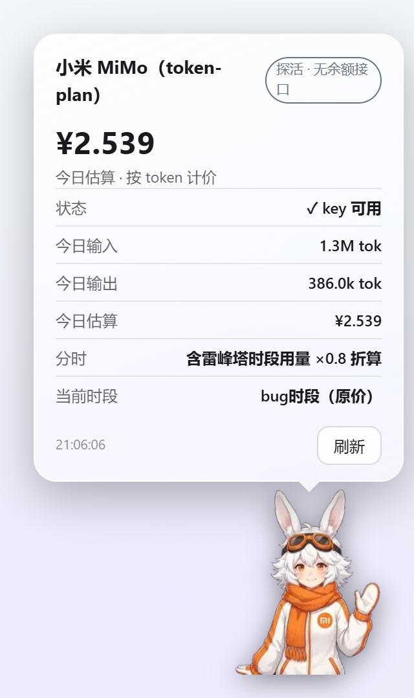

# 余额挂件（hermes-balance-widget）

<picture>
  <source media="(prefers-color-scheme: dark)" srcset="assets/grid-dark.jpg">
  
</picture>

Hermes 桌面客户端右下角的常驻余额挂件：一个卡通角色贴在屏幕角上，**点一下弹出漫画式玻璃气泡**，显示九家厂商的余额 / 订阅额度 / 今日用量——DeepSeek · MiniMax · 智谱 GLM · Kimi · MiMo · ChatGPT · Claude · Gemini · Grok。**随你当前使用的模型自动换角色**（按模型名关键词匹配，不分大小写）；探活厂商按本机 token 用量估算消费；DeepSeek / GLM / MiMo 三家按官方分时规则**自动切价**。

标准 Hermes 磁盘插件：单个 `plugin.js` 放进插件目录即可，无会话令牌、无外发上报、key 只存本机。

> 取数模板结构与字段语义移植自 [DeepSeek-Balance-Whale-Widget](https://github.com/MeteorNOX/DeepSeek-Balance-Whale-Widget)（MIT © MeteorNOX），按九家清单重写为 Hermes 插件形态；定价表口径亦与上游对齐。

## 九家取数层级（13 个取数源，订阅与按量付费分条）

| 层级 | 源数 | 厂商 | 展示内容 |
|---|---|---|---|
| 按量付费 · 真余额 | 3 | DeepSeek、Kimi（CN）、Kimi（国际） | 余额数字（¥ / $）、今日已用 |
| 订阅额度 | 5 | MiniMax（CN / 国际）、智谱 GLM（CN / 国际）、Kimi Coding | 5 小时 / 周窗口剩余 % |
| 探活（官方无余额接口） | 5 | MiMo、ChatGPT、Claude、Gemini、Grok | key 有效性 + 今日估算（token 计价） |

同一厂商的**订阅与按量付费分开成条**：Kimi = 按量（CN）+ Kimi Coding 订阅 + 按量（国际）三源，MiniMax / 智谱 = 国内 + 国际两源，各源独立填 key、独立展示、独立测试连通性。

> 官方不提供「用 key 查余额」接口的厂商不是缺陷而是现实——挂件如实显示探活状态与估算消费，**不伪造数字**。按量消费类 Admin 接口（OpenAI / Anthropic 管理密钥、MiniMax admin key）与各家按量余额缺口，均在设置页对应卡片上注明。

## 特性

### 取数与展示

- 💰 **三态如实**：真余额显示数字，订阅显示窗口剩余百分比，探活显示 ✓ + 今日估算
- 📊 **今日已用**：本地观测余额下降累计（充值不冲掉、跨天重置），仅真余额厂商
- 💬 **每轮消耗**：订阅会话状态，按 `cost_usd` 增量结算；宿主未报成本时回退 token × 单价估算
- 🔄 **60 秒自动刷新** + 气泡内「刷新」按钮手动取数
- 🧠 **模型自动换角色**：命中模型名关键词即换形象与取数目标（`XIAOMI/MIMO-V2.6-PRO` → MiMo），未命中回退设置页选的主厂商，可一键关闭

### 形象与交互

- 🧸 **盒贴角色**：九张形象裁到各自 alpha bbox（宽 160–288 随角色走），左右 / 上方留白为零——点击落在角色本体上，侧翼自然穿透回页面，气泡尖角贴着发顶
- 💬 **漫画气泡**：液态玻璃卡片，日间自动白玻璃、夜间自动深玻璃（跟随 `--theme-background-seed`），越界自动翻转到下方
- 🎈 **Q 弹按压**：按下压缩、松开弹性回弹，配按压音效
- 🖱️ **拖拽 + 贴边吸附**：位置持久化
- 🎚️ **大小调节**：60%–160% 滑杆，拖动实时生效、就地缩放不位移
- 🗨️ **分角色随机语句**：每家一张 ≥5 条的搞怪语句池（取材中文社区对各家模型的调侃），**每次开窗重掷一条**（与上一条不重复），开窗期间每 8 秒轮换

### 计价

- 🧮 **今日估算（token 计价）**：官方无余额接口的厂商，按本机会话的输入 / 输出 token × 每百万单价估算今日消费，缓存命中部分按命中单价计
- ⚙️ **每厂商自定义单价**：输入 / 输出 / 缓存命中 / 缓存创建四格（留空 = 回落默认牌价，填 `0` = 该项免费）
- ⏰ **分时自动切价**（DeepSeek / GLM / MiMo）：配置价 = 日间价，命中非高峰窗口自动乘系数（见下方定价表）；**窗口按北京时间判定**，与本机时区无关
- 🧾 **跨窗口不串价**：今日 token 按记账当刻所在窗口分流两个桶，跨窗口用量各按各价结算

### 提醒与音效

- 🔔 **余额预警**：低于阈值时提示 + 预警音（每次穿越只警一次，回升自动复位）
- 🎵 **任务结束音**：一轮回答完成时播放（WebAudio 实时合成，不依赖外部素材）

## 安装（Hermes 桌面端）

1. 从 [Releases](../../releases) 下载最新版的 **`plugin.js`**
2. 打开 Hermes 的 **技能与工具 → 插件** 页，点 **「打开插件目录」**（文件夹图标）——它会直接打开本机真实的插件根目录，**不要手动猜路径**（各平台默认位置不同）
3. 在插件根目录下新建文件夹 `hermes-balance-widget`，把 `plugin.js` 放进去
4. 回到插件页点 **刷新** ↻

**成功信号**：出现 toast「💰 余额挂件插件已加载 · 设置入口：侧栏「余额挂件」」，插件列表里出现「余额挂件」条目，右下角出现挂件角色。



> ⚠️ 改动插件目录里的**单个文件不会触发自动重载**（监视器只盯目录级事件）——每次都要手动点「刷新」。

## 配置教程

### 1. 填 API key（必做）

打开设置页，三选一：**侧栏**左下「余额挂件」 / **命令面板** `Ctrl+Shift+K` → 「余额挂件：打开设置」 / 直接访问路由 `/balance-widget`。

设置页里每家一张卡，卡内**每个取数源一行**（订阅与按量付费分列）：

| 字段 | 说明 |
|---|---|
| 源标题 + 层级徽标 | 「订阅 · 国内」「按量付费 · 国际」等，决定该行数据形态 |
| key 输入框 | 密码框，**只存本机插件存储（localStorage），不出本机**；首源沿用旧存储键，升级零迁移 |
| 测试连通性 | 填了 key 会向厂商官方接口发一次真实查询，显示余额 / 窗口 / 探活结果 |

各厂商 key 获取处：

| 源 | 控制台 |
|---|---|
| DeepSeek 按量付费 | platform.deepseek.com → API Keys |
| MiniMax 订阅（国内） | platform.minimaxi.com → 接口密钥（仅 Coding Plan 订阅账号有效） |
| MiniMax 订阅（国际） | api.minimax.io 对应平台，独立账号与 key |
| 智谱 GLM 订阅（国内） | open.bigmodel.cn → API Keys |
| 智谱 GLM 订阅（国际） | z.ai 平台，独立账号与 key |
| Kimi 按量（国内） | platform.moonshot.cn → API Keys |
| Kimi Coding 订阅 | kimi.com/code 控制台 → 独立 key（与 Moonshot API key 不通用） |
| Kimi 按量（国际） | api.moonshot.ai 对应平台，独立账号与 key |
| MiMo | token-plan 端点（无余额接口，填 key 仅探活） |
| ChatGPT / Claude / Gemini / Grok | 各家官方 API 控制台（均无余额接口，填 key 仅探活） |

未配置的源显示「未配置 key」，不影响同厂商其他源展示。

### 2. 挂件控制（设置页顶部）

| 设置 | 说明 |
|---|---|
| 显示右下角挂件 | 总开关 |
| 挂件大小 | 60%–160% 滑杆，拖动实时生效 |
| 跟随当前模型自动换角色 | 按当前模型名关键词（不分大小写）自动换形象与取数；关闭则固定为主厂商 |
| 主厂商 | 九宫格点按切换——自动换角色开启时，它是「关键词未命中」的回退角色 |
| 音效（按压 / 任务结束 / 预警） | 总开关 + 音量 |
| 弹窗随机语句 | 气泡底部那行小字 |
| 余额预警 + 阈值 | 低于阈值（如 `5`）时提示 + 预警音，仅真余额厂商生效 |

### 3. 单价与分时（每家卡片底部）

四格单价输入——输入 / 输出 / 缓存命中 / 缓存创建（厂商币种；**缓存创建暂无宿主数据源，估算不计**，保留配置位）。留空 = 用内置默认牌价；填 `0` = 该项免费。单价栏下方实时显示今日估算、token 用量与**当前生效时段**。

### 4. 日常交互

- **点角色**：Q 弹按压 → 弹出玻璃气泡（再点或点外部关闭）
- **按住拖动**：近屏幕边缘自动吸附
- **气泡内「刷新」**：立即重新取数
- **切主题**：日间白玻璃 / 夜间深玻璃，自动跟随，无需设置

## 定价表（默认牌价，每百万 tokens）

金额为**厂商币种**；分时厂商写成「[日间 / 高峰] → [夜间 / 非高峰]」。表在 `src/pricing.js` 的 `DEFAULT_PRICES` / `SCHEDULES`，官方调价时改这里，或在设置页直接覆盖。

| 厂商 | 输入 | 输出 | 缓存命中 | 缓存创建 | 分时 |
|---|---|---|---|---|---|
| DeepSeek（V4.1-Flash） | 2 → 1 | 8 → 4 | 0.04 → 0.02 | — | 小楠梁时段 / 梁圣时段 ×0.5 |
| 智谱 GLM（5.3-Flash） | 0.8 → 0.4 | 2.8 → 1.4 | 0.23 → 0.115 | — | 贼时段 / 一哥时段 ×0.5 |
| MiMo（V2.5） | 1 | 2 | 0.02 | — | bug时段 / 雷布斯时段 ×0.8 |
| Kimi（K3，CN） | ¥20 | ¥100 | ¥2 | ¥20 | — |
| MiniMax（M2.7） | ¥7.2 | ¥36 | — | — | — |
| ChatGPT（GPT-5.6 Sol） | $4 | $20 | $0.40 | — | — |
| Claude（Sonnet 5） | $2 | $10 | $0.20 | $2.5 | — |
| Gemini（3.5 Flash） | $1.5 | $9 | $0.15 | — | — |
| Grok（4.6） | $2 | $6 | $0.50 | — | — |

**分时窗口（均按北京时间）**：

| 厂商 | 日间 / 高峰（原价） | 夜间 / 非高峰（折价） |
|---|---|---|
| DeepSeek | 工作日 9:00–12:00、14:00–18:00 | 其余时段 + **周末全天**，×0.5 |
| GLM | 工作日 14:00–18:00 | 其余时段，×0.5（Coding Plan 积分 50% 抵扣） |
| MiMo | 8:00–24:00 | 0:00–8:00，×0.8 |

> 牌价来自 2026-10 官方文档 / 社区查证，各条注在源码里；厂商调价后**改设置页单价即可**，不必等插件更新。DeepSeek 已含 2026-08-17 峰谷定价与周末谷价规则。

## 常见问题

- **挂件不出现**：确认 `plugin.js` 放进了插件根目录下的独立文件夹（不是散放在根目录），然后点插件页「刷新」。看 toast 有没有出现——没 toast 说明插件没加载。
- **改了 `plugin.js` 不生效**：插件监视器只监听目录级事件，改单文件必须手动点「刷新」。
- **点角色没反应 / 点偏了**：角色热区就是它的紧裁盒——点在角色身上才有反应；透明侧翼的点击会穿透到底下页面（刻意行为，不会误触）。角色贴到屏幕下缘时，气泡自动翻到下方。
- **探活厂商余额显示「—」**：官方没有「用 key 查余额」接口，显示「—」不是 bug；它的气泡主数值是**今日估算**（token 计价）。
- **今日估算不显示 / 显示「单价未配置」**：探活厂商需要先有本机 token 用量记录（用该厂商的模型跑过对话），且输入 / 输出单价可得（默认牌价即有；手动清空且无默认价时才提示未配置）。
- **今日已用一直是 ¥0**：它靠余额下降观测累计，起点是**首次成功取数那一刻**，之前的消费不在区间内；充值不会减少它。
- **分时档位看不懂**：档位名是自定义的（DeepSeek 小楠梁 / 梁圣时段等），规则见上方定价表；气泡里「当前时段」行实时显示此刻档位，估算已按该档折算。
- **key 会传到哪儿**：只存在本机插件存储（localStorage），请求只发给对应厂商的官方接口；插件没有任何第三方上报。
- **每轮消耗不出现**：一轮对话要完整结束才结算；宿主未报 `cost_usd` 时回退 token × 单价估算，需要该厂商单价可得。

## 数据与隐私

- 各厂商 API key 由用户在设置页填写，**仅存本机插件存储，不出本机**
- 网络请求只有向各厂商官方接口发起的余额 / 额度 / 探活查询，**无任何第三方上报**
- 「今日已用」「今日估算」「每轮消耗」均为**本地观测估算**，与厂商账单可能有差异（缓存创建等明细宿主未提供）
- 仓库内含 `.gitignore` 拦截 `*.secret` / `.env`；本仓库不含任何本机路径、用户名、密钥或环境标识

## 开发与维护

```bash
python build.py        # 组装单文件 plugin.js（逐条 assert 手术 + node --check 语法门，不过不写产物）
node test/smoke.mjs    # 冒烟：九家模板（13 源）/ 取数三态 / 模型匹配 / 分池语句 / token 计价 / 分时窗口 / 注册结构
```

- 源码分工：`src/providers.js` 取数模板、`src/balance.js` 取数执行器（字段路径 `a.b[0].c`）、`src/pricing.js` 定价与分时、`src/widget.js` 挂件本体、`src/shell.js` 设置页与注册；`build.py` 拼装并把九张形象以 base64 注入 `MASCOTS`
- 素材管线（`tools/`）：`compress_assets.py` 压缩原图 → `cutout_rembg.py` 语义分割抠图（rembg + alpha matting）→ `diag_edge.py` 边缘质检
- 改完源码跑一遍 `build.py` + `smoke.mjs`，再回插件页「刷新」

## 素材与版权

- **九张角色形象**：本项目自行 AI 生成 + 手工抠图（`assets/transparent/*.webp` 为参与构建的成品，`assets/*.jpg` 为原始生成图，仅作溯源）。其中 MiMo 形象参照小米「米兔」风格——相关角色形象权利归**小米公司**，此处仅作厂商标识使用；若权利人提出异议会立即替换。
- **厂商名称与标识**（DeepSeek、MiniMax、智谱、Kimi、MiMo、ChatGPT、OpenAI、Claude、Anthropic、Gemini、Google、Grok、xAI）为各自所有者的商标，本项目仅在描述取数来源时作为产品标识使用，无隶属或背书关系。
- **音效**：全部用 WebAudio 实时合成，未使用任何第三方音频素材。

## 致谢

- [DeepSeek-Balance-Whale-Widget](https://github.com/MeteorNOX/DeepSeek-Balance-Whale-Widget)（作者 **月匠 MeteorNOX**）：本项目移植了它的取数模板结构、余额 / 额度字段语义与分时定价口径——原版是 DSH Web 界面的完整记账挂件，功能远比本插件丰富，值得一并看看。
- 各厂商中文社区对模型的调侃，构成了九张角色语句池的取材来源。

## License

[MIT](./LICENSE) — 含上游 DeepSeek-Balance-Whale-Widget 版权声明（© MeteorNOX）。
